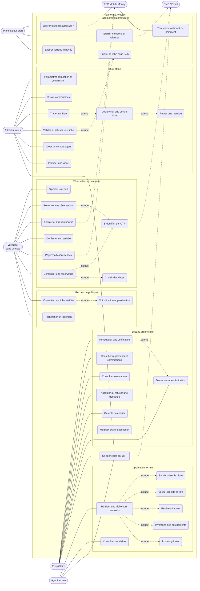

# Diagramme de cas d'utilisation — Ayostay (v1)

Périmètre : CDC v1, backlog `docs/agile/product-backlog.md` (épics 0 à 7).
Source PlantUML éditable : [`cas-utilisation.puml`](cas-utilisation.puml).
Les éléments hors périmètre (CDC §9 : avis, messagerie, hôtels, app native…) n'apparaissent pas.

## Acteurs

| Acteur | Rôle | Authentification |
|---|---|---|
| Voyageur | Recherche, réserve, paie, confirme son arrivée, signale un écart | Aucun compte : session éphémère de 6 h, OTP au moment de réserver |
| Propriétaire | Fait vérifier ses biens, tient son calendrier, accepte les demandes | Téléphone ou email + OTP (`/connexion`) |
| Agent terrain | Réalise les visites de vérification, y compris hors connexion | Téléphone ou email + OTP (`/terrain/connexion`), compte créé par l'admin |
| Administrateur | Valide les fiches, planifie les visites, traite les litiges | Téléphone ou email + OTP (`/admin/connexion`) |
| Planificateur (cron) | Déclenche les traitements périodiques | Secret `CRON_SECRET` / scripts |
| PSP / Mobile Money | Exécute les paiements, appelle le webhook | Simulateur tant que le CDC §12 n'est pas tranché |
| Fournisseur SMS / Email | Livre les codes OTP et relances | `SMS_PROVIDER=console` en production aujourd'hui |

## Diagramme

## Description des cas d'utilisation principaux

| Cas | Acteur | Pré-condition | Résultat | CDC |
|---|---|---|---|---|
| Rechercher un logement | Voyageur | Aucune | Liste de biens vérifiés filtrée, légère pour réseau lent | §6.1.1–2 |
| Demander une réservation | Voyageur | Bien vérifié, dates libres, OTP validé | Réservation en attente, jours verrouillés jusqu'au paiement | §6.2, §7.3 |
| Accepter une demande | Propriétaire | Demande en attente | Intention de paiement créée | §6.3.4, §8.1 |
| Payer | Voyageur | Demande acceptée | Paiement confirmé par webhook vérifié ; infos d'accès débloquées | §6.2.3, §8.4 |
| Confirmer son arrivée | Voyageur | Paiement confirmé | Ordre de libération des fonds et commission | §5.1.7, §8.6 |
| Réaliser une visite | Agent | Visite affectée | Fiche de visite complète (< 45 min), synchronisée au serveur | §4.1, §11.1 |
| Valider une fiche | Administrateur | Visite complétée | Mention « Vérifié » (12 mois), fiche publiée sous 24 h | §4.1.8, §11.2 |
| Signaler un écart | Voyageur | Séjour en cours | Litige ouvert, contre-visite possible, retrait de mention éventuel | §4.2, §6.5.3 |

## Règles métier à retenir

- Un bien n'est publié qu'avec une `Verification`, qui exige une `Visit` complétée.
- Le propriétaire écrit prix, titre et description ; quartier, GPS, repères et équipements confirmés viennent de la visite.
- Les coordonnées et `accessInfo` restent masquées tant que le paiement n'est pas confirmé.
- Le statut de paiement ne change que sur webhook vérifié.
