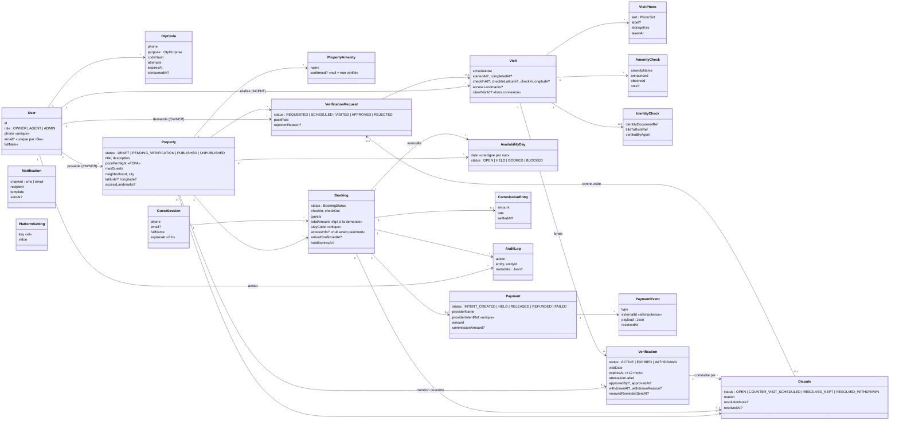

# Diagramme de classes — modèle de données

Source de vérité : `prisma/schema.prisma` (20 modèles). Seuls les attributs structurants sont reproduits.

## Invariants portés par le schéma

- `Verification` a une FK obligatoire vers `Visit` et une seule mention courante par bien (`propertyId` unique) ; la complétion de la visite est contrôlée par le flux d'approbation.
- `AvailabilityDay` : unicité `(propertyId, date)` ; l'absence de ligne vaut `OPEN`.
- `Booking.totalAmount` est figé à la demande ; `accessInfo` reste `null` jusqu'au paiement confirmé.
- `PaymentEvent.externalId` unique : un événement PSP n'est traité qu'une fois.
- `User` : `phone` unique, `(role, email)` unique.
- Le voyageur n'a pas de modèle `User` : seulement `GuestSession`.
