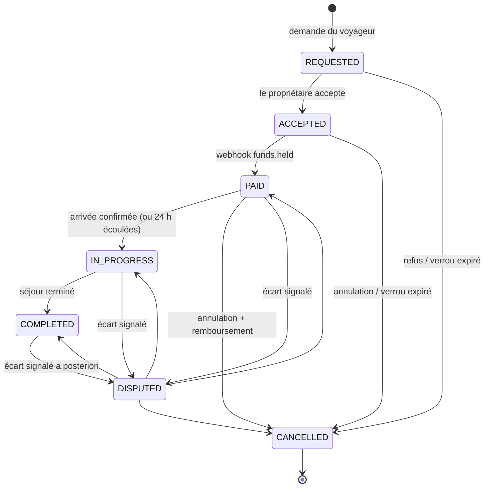
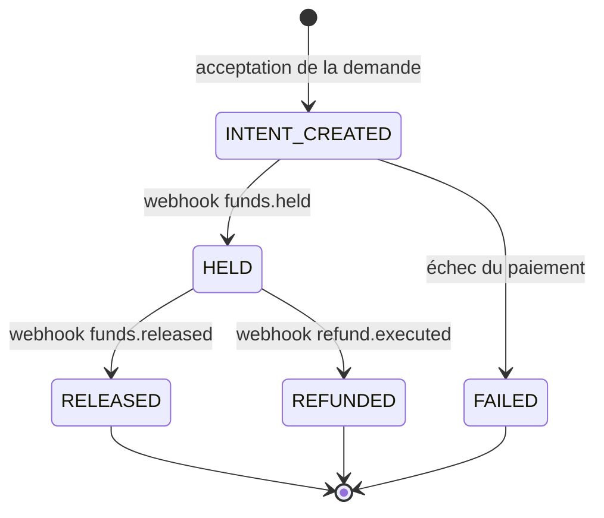
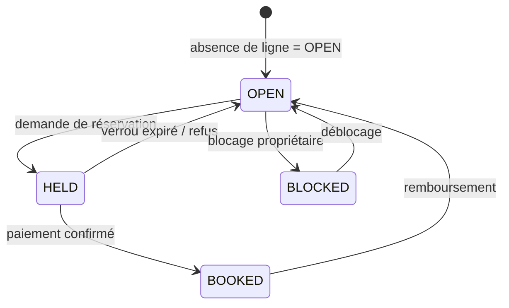
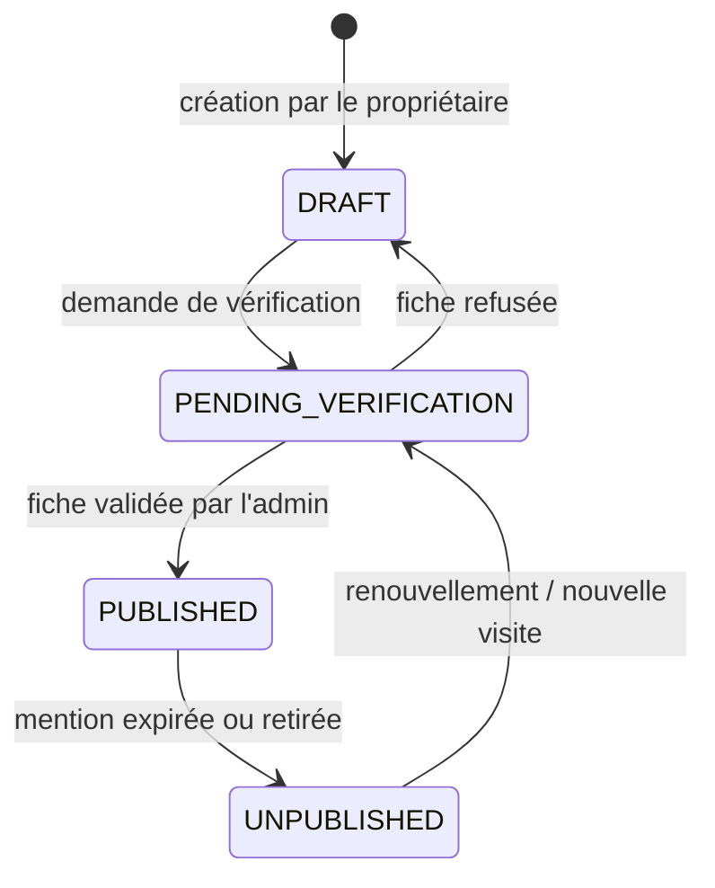
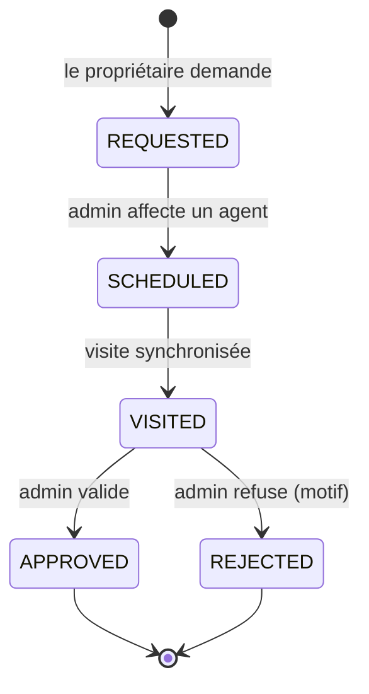
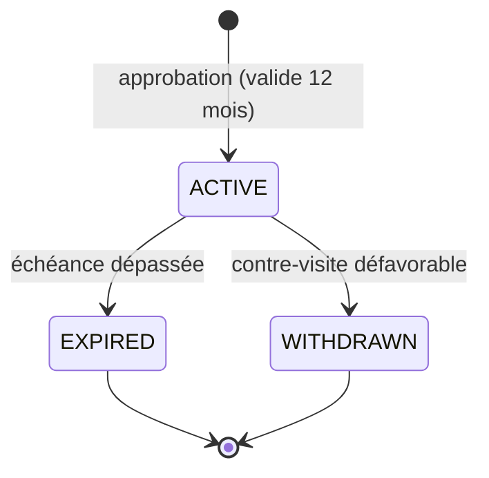
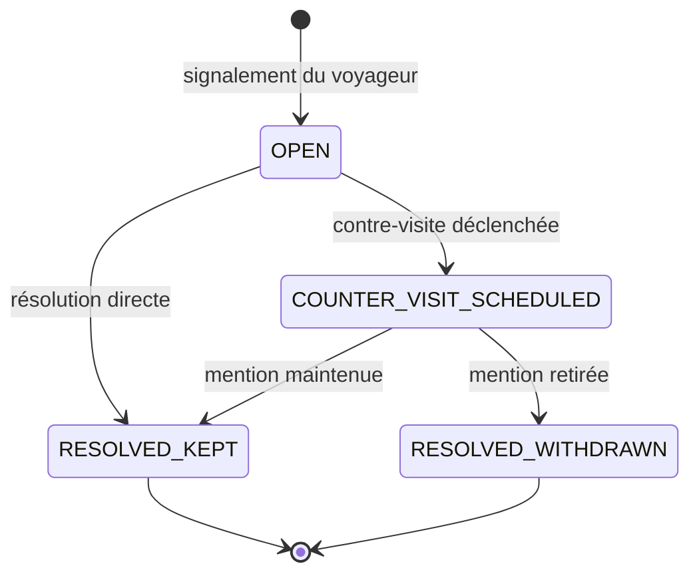

# Diagrammes d'états

## Réservation (`Booking.status`)

Table de transitions de `src/lib/booking/state-machine.ts` (CDC §7.2). Toute transition est journalisée dans `AuditLog` (`booking.transition`).

## Paiement (`Payment.status`)

L'état ne change que sur webhook vérifié, jamais sur la foi d'un appel sortant.

## Disponibilité (`AvailabilityDay.status`)

## Bien (`Property.status`)

## Demande de vérification (`VerificationRequest.status`)

## Mention (`Verification.status`) et litige (`Dispute.status`)

## Réserves

Les tables `Booking` ci-dessus reprennent le code. Pour les autres machines (bien, demande de vérification, mention, litige), les transitions sont déduites du schéma, du backlog et du README, pas d'une table de transitions dans le code : à confirmer en relisant `src/lib/verification/` avant de les considérer comme normatives. En particulier, je n'ai trouvé aucun appel qui fait passer une réservation `IN_PROGRESS → COMPLETED`.
