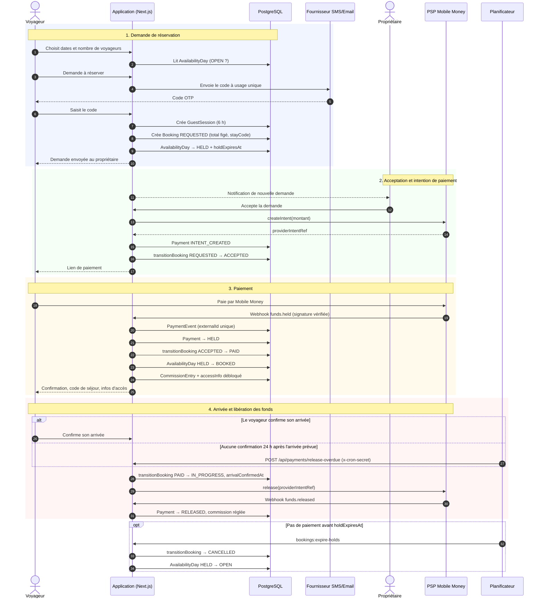

# Diagramme de séquence — réservation, paiement et libération des fonds

Parcours nominal du CDC §6.2, §7.3, §8. Chaque changement de statut de réservation passe par `src/lib/booking/state-machine.ts` ; le statut de paiement ne change que sur webhook vérifié (`src/lib/payments/webhook-handler.ts`).

## Points d'attention

- **Idempotence** : un webhook rejoué est ignoré grâce à `PaymentEvent.externalId`.
- **Libération rejouable** : si l'ordre `release()` échoue, l'arrivée reste confirmée et le paiement reste `HELD` ; la route `release-overdue` retente (décision 0012).
- **Annulation avec remboursement** : le webhook `refund.executed` passe le paiement à `REFUNDED`, la réservation à `CANCELLED`, libère les nuits et supprime la commission non réglée.
